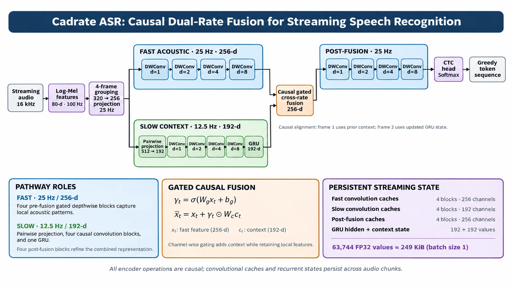

<h1 align="center">Beyond Recognition Accuracy</h1>
<p align="center"><b>Efficient CPU Streaming ASR for Dysarthric Speech</b><br>
and <b>Cadrate ASR</b>, a 2.70M-parameter dual-rate streaming prototype</p>

<p align="center">
  <a href="https://sanjidh090.github.io/Cadrate-ASR/"></a>
  <a href="https://sanjidh090.github.io/Cadrate-ASR/assets/paper.pdf"></a>
  <a href="https://sanjidh090.github.io/Cadrate-ASR/assets/slides.pdf"></a>
  
</p>

<p align="center">
Sanjid Hasan<sup>1</sup>, Zaina Rahman<sup>2</sup>, Suhita Islam Aurthi<sup>2</sup>, Md Rashaduzzaman Rakib<sup>2</sup>, Sadia Jahan Turabe<sup>2</sup>, Md. Wasif Rahman<sup>2</sup><br>
<sup>1</sup>Dept. of EEE, <sup>2</sup>Dept. of CSE, Khulna University of Engineering &amp; Technology (KUET), Bangladesh
</p>

---

Our system for **Track 2 (Streaming ASR)** of the **Speech Accessibility Project Challenge 2 (SAPC2)**. Audio arrives in 100-ms chunks, inference runs strictly on CPU, and systems are scored on both accuracy (CER/WER) and responsiveness (TTFT-stable/TTLT).

## Highlights

- **22.18% CER / 31.73% WER** on the official SAPC2 Test1 leaderboard, against the baseline's 34.59% CER. Median TTFT-stable is **1.38 s** and median TTLT is **117 ms**, running on CPU.
- A **66.1M-parameter causal Zipformer transducer**, fine-tuned on 742.72 h of SAPC2 audio plus TORGO and 41,850 synthetic TTS utterances.
- **Digit-token vocabulary transplantation (500 → 510 BPE)**: the model writes `0`–`9` directly, and the original token IDs and pretrained weights stay intact.
- **Mixed-precision INT8 ONNX** (INT8 encoder and joiner, FP32 predictor), streamed through [sherpa-onnx](https://github.com/k2-fsa/sherpa-onnx).
- **4-path beam search** lowers local WER from 21.74% to **19.47%** (12.59% CER) without retraining.
- **Perceptual error audit** of 437+ utterances: WER rises from **19.30% on clear speech to 57.28% on unclear speech**. Perceived clarity predicts errors at least as well as clinical etiology.
- **Cadrate ASR**: a 2.70M-parameter dual-rate causal CNN–GRU with a fixed **249 KiB** streaming state. Its CPU cost is lower than the Zipformer's, but it needs pretraining to be accurate.

## Results

### Official SAPC2 Test1 leaderboard (CPU, 100-ms chunks)

| System | WER (%) ↓ | CER (%) ↓ | TTFT-stable ↓ | TTLT ↓ |
|---|---:|---:|---:|---:|
| SAPC2 Track 2 baseline | 52.77 | 34.59 | — | 367 ms |
| **Ours: Zipformer INT8 (greedy)** | **31.73** | **22.18** | **1.38 s** | **117 ms** |

### Local development evaluation

| System | Split | WER (%) | CER (%) | Notes |
|---|---|---:|---:|---|
| Whisper Large-v3, zero-shot | Dev (offline) | 36.56 | 15.34 | RTF > 1.0 on CPU |
| Parakeet RNN-T, fine-tuned | Dev (offline) | 22.22 | 9.67 | RTF > 1.0 on CPU |
| Zipformer, pretrained, zero-shot | Dev-501 (stream) | 58.20 | 34.91 | |
| Zipformer, fine-tuned (validation) | Dev-501 (stream) | 27.48 | 18.90 | |
| Zipformer E19 INT8, greedy | Dev-501 | 21.74 | — | 140 s total decode |
| **Zipformer E19 INT8, beam-4** | Dev-501 | **19.47** | **12.59** | 157 s total decode |
| Zipformer E19 INT8, beam-4, 1.28 s padding | Dev-100 | 19.44 | 12.58 | 277 s total decode |

Beam-search results are local only. The leaderboard submission used greedy decoding.

### WER by perceived speech characteristic (501-utterance set)

| Characteristic | n | Zipformer E19 (ours) | FastConformer | Nemotron INT4 |
|---|---:|---:|---:|---:|
| Clear | 152 | **19.30** | 40.15 | 33.03 |
| Slow | 21 | **21.02** | 42.05 | 28.30 |
| Muffled | 30 | **23.08** | 40.00 | 38.46 |
| Drowsy | 25 | **28.68** | 67.55 | 49.81 |
| Imprecise articulation | 19 | **33.56** | 77.18 | 77.85 |
| Stammered | 16 | **33.95** | 72.84 | 70.37 |
| Slurred | 48 | **35.30** | 68.05 | 62.30 |
| Unclear | 46 | **57.28** | 89.74 | 90.40 |

Perceptual tags are the authors' listening judgements, not clinical diagnoses.

## Method

```
SAPC2 data ──► Text & vocab ──► Adaptation ──► ONNX export ──► CPU streaming ──► Evaluation
742.72 h       normalized        causal          INT8 encoder/    sherpa-onnx       WER / CER
+ 41.8k TTS    targets,          Zipformer,      joiner,          100-ms chunks,    TTFT-stable / TTLT
+ TORGO + aug  500 → 510 BPE     16–32f chunks,  FP32 predictor   greedy / beam-4   perceptual audit
                                 SpecAugment
```

| Setting | Value |
|---|---|
| Base model | Streaming Zipformer RNN-T, ~66.1M params ([icefall](https://github.com/k2-fsa/icefall)) |
| Hardware | 1× NVIDIA RTX 4070 (12 GB), FP16 mixed precision |
| Learning rate | 3 × 10⁻⁵ |
| Batching | Dynamic, ≤ 120 s of audio per batch |
| Chunk size / left context | Random 16–32 frames / 128 or 256 frames |
| Epochs | 19 (E19 selected) |
| Augmentation | SpecAugment, Qwen-TTS + Kokoro-TTS, TORGO, 6-stage acoustic distortion |

The 6-stage distortion pipeline applies, in order: Gaussian noise (σ = 0.02), 0.9× time stretch, +2-semitone pitch shift, a 4 kHz Butterworth low-pass filter, a single-tap echo (0.25 s, 0.4 decay) and five-tap reverb (0.03–0.22 s).

## Cadrate ASR

<p align="center"></p>

Cadrate ASR tests the lower limit of CPU compute and streaming memory. It stacks four 100 Hz filterbank frames into a **25 Hz fast acoustic pathway**: 256 channels and gated depthwise dilated convolutions with k = 7 and d ∈ {1, 2, 4, 8}. Alongside it runs a **12.5 Hz slow context pathway**: 192 channels, four causal convolution blocks and a unidirectional GRU. A causal sigmoid-gated fusion joins the two, and a framewise CTC head decodes greedily.

$$\gamma_t = \sigma(W_g x_t + b_g), \qquad \tilde{x}_t = x_t + \gamma_t \odot W_c c_t$$

$$N_\text{state} = 2(256)(6)(1{+}2{+}4{+}8) + (192)(6)(1{+}2{+}4{+}8) + 192 + 192 = 63{,}744 \text{ values} \approx 249\text{ KiB (FP32)}$$

| | Adapted Zipformer | Cadrate ASR |
|---|---|---|
| Encoder | Multi-rate causal Transformer (6 stacks) | Dual-rate causal depthwise CNN–GRU |
| Frame rates | 50, 25, 12.5, 6.25, 12.5, 25 Hz | 25 Hz fast, 12.5 Hz slow |
| Objective | Pruned RNN-T (greedy / beam-4) | Framewise CTC (greedy) |
| Inference state | Attention caches + RNN-T predictor | Fixed 249 KiB conv/GRU caches |
| Parameters | ~66.1M (pretrained + fine-tuned) | ~2.70M (from scratch) |

Cadrate ASR achieved a lower CPU real-time factor and lower P95 chunk latency than the Zipformer. Trained from scratch on SAPC2 alone, though, its WER is high and it does not generalize to unseen speakers. A pretrained Cadrate is the next step.

## Repository layout

```
Cadrate-ASR/
├── docs/            project page (GitHub Pages: https://sanjidh090.github.io/Cadrate-ASR/)
│   ├── index.html
│   └── assets/      figures, CSS/JS, paper and slides PDFs
└── README.md
```

<!-- Add your code folders here, e.g. training recipes, export scripts, Cadrate model code, and usage instructions. -->

## Data

SAPC2 data are available under the [Speech Accessibility Project](https://speechaccessibilityproject.beckman.illinois.edu/) data-use agreement and **cannot be redistributed**. This repository contains no SAPC2 audio or transcripts.

## Limitations

- Components were not ablated in isolation (TTS data, TORGO, vocabulary expansion).
- Decoding settings were tuned on the reported development set, and beam-search gains are local only.
- Results are single-run point estimates, and some perceptual subgroups are small.
- Perceptual tags are subjective author annotations. Cadrate ASR is exploratory.
- Scope is English SAPC2 data only.

## Citation

```bibtex
@misc{hasan2026beyond,
  title  = {Beyond Recognition Accuracy: Efficient {CPU} Streaming {ASR}
            for Dysarthric Speech},
  author = {Hasan, Sanjid and Rahman, Zaina and Aurthi, Suhita Islam and
            Rakib, Md Rashaduzzaman and Turabe, Sadia Jahan and
            Rahman, Md. Wasif},
  year   = {2026},
  note   = {Speech Accessibility Project Challenge 2, Track 2 (Streaming ASR)},
  url    = {https://sanjidh090.github.io/Cadrate-ASR/}
}
```

## Acknowledgements

Built on [icefall](https://github.com/k2-fsa/icefall), [sherpa-onnx](https://github.com/k2-fsa/sherpa-onnx) and the [Zipformer](https://arxiv.org/abs/2310.11230) streaming recipe. We thank the Speech Accessibility Project and the SAPC2 organizers for the data and evaluation infrastructure.

## Contact

Sanjid Hasan: [hasan2203090@stud.kuet.ac.bd](mailto:hasan2203090@stud.kuet.ac.bd)
